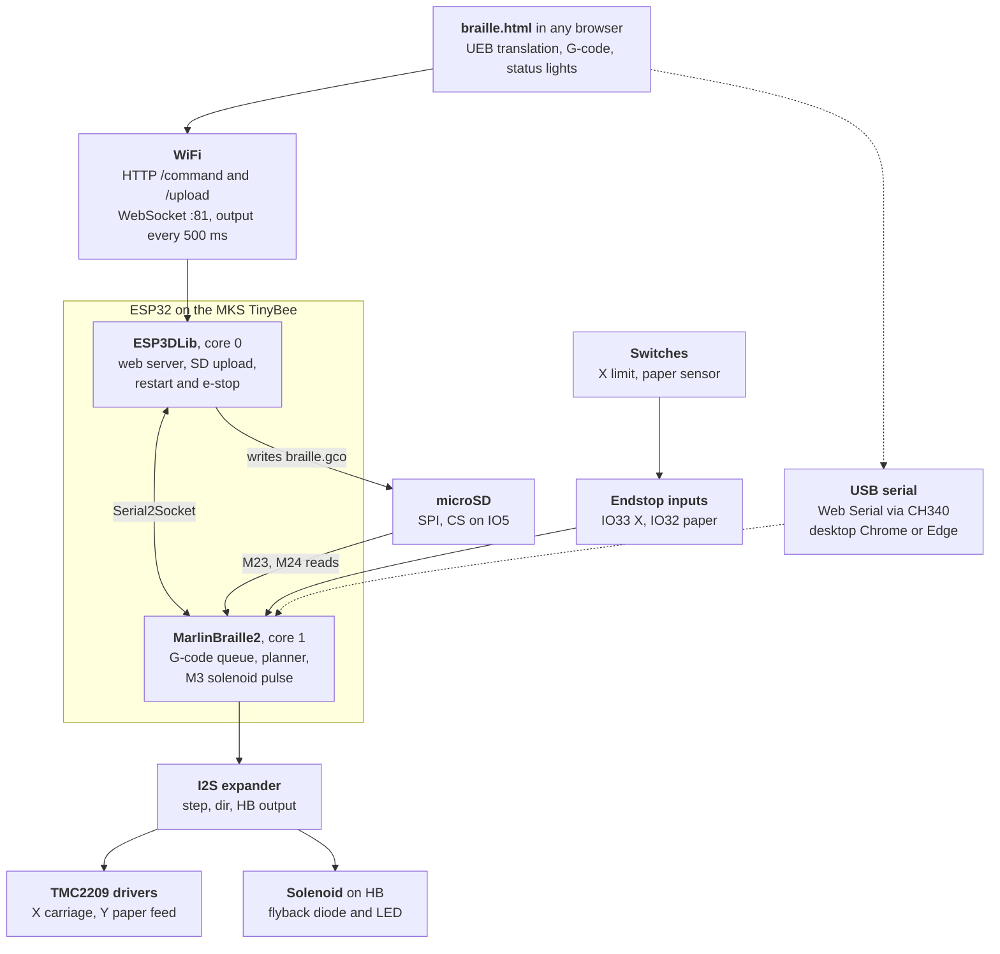
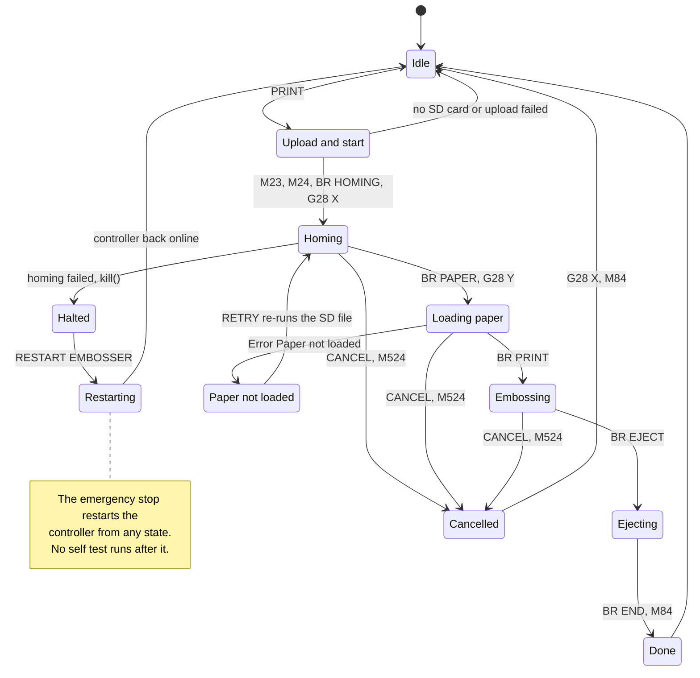

# BrailleRAP SG UI

Web interface for the Singapore **BrailleRAP XL** embosser. Type text on a phone or computer, preview the Braille, and emboss it over **WiFi**. The page itself is served from the embosser's ESP32 (MKS TinyBee running [MarlinBraille2 `xl-sg`](https://github.com/saadcaffeine/MarlinBraille2/tree/xl-sg) with ESP3D).

Fork of [kyjanond/BrailleRapUI](https://github.com/kyjanond/BrailleRapUI) (BrailleRap Bhutan, MIT). Thanks, Ondrej and the ALU team at CST Fablab.

## What's different from the Bhutan version

- **WiFi printing via the SD card.** The G-code is uploaded to the embosser's microSD card through ESP3D (`/upload`), then started with `M23`/`M24`. Progress comes from `M27`, and **Cancel** sends `M524`. The job runs from the card, so it keeps going if the phone sleeps. USB (Web Serial, desktop Chrome/Edge) is still available as an option.
- **English UEB Grade 1** table: capital and capitalised-word indicators, numeric indicator, grade 1 indicator after numbers, and UEB punctuation. The original `english` table was actually **French** Braille, so it is now labelled *French (original BrailleRap)*.
- **Paper presets:** A3 (BrailleRAP XL, default), A4 on XL, and A4 (original BrailleRAP).
- **Braille size:** *standard* (2.5 mm dot / 6 mm cell / 10 mm line) by default, or the original larger Bhutan spacing.
- Warns when text overflows the sheet or contains characters the table can't translate.
- Settings are remembered in the browser. The default baud rate is 250000 (MarlinBraille2).
- Single-file build for the ESP32: `esp/braille.html.gz`, about 260 KB.

## How it works

### From the page to the electronics

The page runs entirely in the browser and talks to the embosser's ESP32 over WiFi. ESP3DLib (core 0) serves the page, takes the G-code upload to the SD card and passes commands to MarlinBraille2 (core 1), which drives the motors and the solenoid. A USB cable to a desktop browser (dotted path) is the fallback.



Three details matter when debugging:
- **Bursty updates.** ESP3DLib's Serial2Socket forwards Marlin's output to the WebSocket only every 500 ms, so the dot count and preview update in steps rather than per dot.
- **Two writers on the SD card.** ESP3DLib writes `braille.gco` during an upload, and Marlin reads it with `M23` and `M24`. Config changes need a **clean build** of the firmware, or ESP3DLib can end up compiled without SD support.
- **The emergency stop bypasses Marlin.** It asks ESP3DLib to restart the whole ESP32 (`[ESP444]RESTART`), so it works even when Marlin is halted or busy homing. `M112` would only wait in Marlin's queue.

### Job states

A print job as the page and the firmware see it. The G-code carries `M118 BR:` markers (`HOMING`, `PAPER`, `PRINT`, `DOT n/N`, `EJECT`, `END`), which drive the staged progress bar.



- **Cancel during homing or paper loading** only takes effect once that move ends, because `G28` blocks Marlin's queue.
- **Lost contact is not a state.** The job keeps running from the SD card, and the page picks it up again when contact returns, or after a reload.

## Install on the embosser

1. Flash [MarlinBraille2 `xl-sg-v1.0.0`](https://github.com/saadcaffeine/MarlinBraille2/releases/tag/xl-sg-v1.0.0) or later. It needs `ESP3D_WIFISUPPORT` and `SDSUPPORT`, built with a **clean build**. Put a FAT32 microSD card in the TinyBee.
2. Join the embosser's WiFi and open `http://192.168.0.1/?forcefallback=yes`.
3. Upload **`esp/braille.html.gz`** to the ESP3D flash (the same place as `index.html.gz`). Keep the file name.
4. Open **`http://192.168.0.1/braille.html`**. ESP3D serves the gzipped file automatically.

ESP3D's own interface stays at `http://192.168.0.1/` for setup and manual control.

## Develop

```
yarn install
yarn dev          # https://localhost:8080 (USB / Web Serial)
yarn build:esp    # -> dist-esp/braille.html(.gz) for the ESP32
```

### Test against a mock embosser

`test/esp3d-mock/` has a mock ESP3D + Marlin server (upload, `M23`/`M24`/`M27`/`M524`, websocket) and a Playwright test. The test types text on a phone-sized screen, prints, decodes the uploaded G-code back into Braille cells and checks them against UEB, then checks cancel.

```
cd test/esp3d-mock && npm install
node server.mjs ../../dist-esp/braille.html.gz &
python3 test_flow.py
```

## Limitations

- Grade 2 (contracted) UEB is not supported yet. It needs a rule-based translator such as LibLouis.
- One sheet per job: text that doesn't fit is cut off, with a warning.

---


# BrailleRapUI
- See current version online: https://braille-rap-ui.ok-y.xyz
- This project was created as a part of the team effort of the **Assistive Learning Units (ALU)** group from the CST Fablab in Phuentsholing, Bhutan for the Fab Bhutan Challenge 2023 - Designing Resilient Futures. 
- The project was created for the BrailleRap Bhutan iteration https://github.com/kyjanond/BrailleRap
- Parts of the code are modified pieces of the https://github.com/crocsg/BrailleRap project.
- It was created fast, dirty and it probably contains lots of bugs. No guarantees.
- To be able to send the data your browser needs to support the web Serial API (more info: https://developer.mozilla.org/en-US/docs/Web/API/Serial)

### install and run locally
```
yarn install
yarn dev
```

### usage
- connect an opensource BrailleRap printer (see: https://github.com/kyjanond/BrailleRap) with a USB cable
- type text in the input area and hit 'generate'
- hit 'print' and select the connected printer in the popup dialog
- wait for the result
